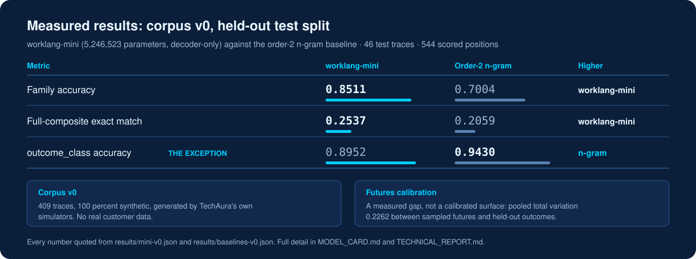
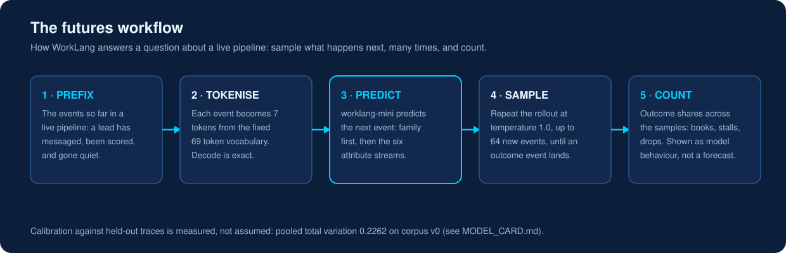
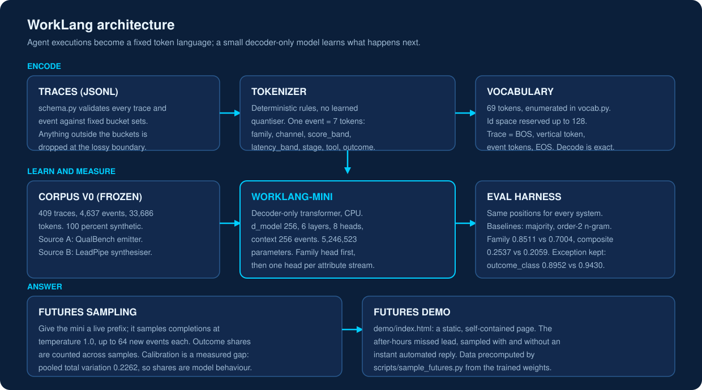
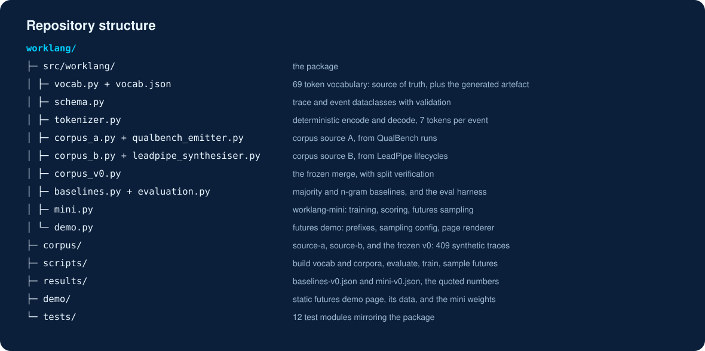

# WorkLang

<p align="center">
  <a href="LICENSE"></a>
  <a href="https://github.com/techaurah/worklang/actions/workflows/ci.yml"></a>
  
  
  <a href="https://www.linkedin.com/company/techaurah/"></a>
</p>

<p align="center">
  
</p>

WorkLang is a small foundation model for the language of agent
workflows: it tokenises agent executions into a fixed semantic
alphabet, learns to predict what happens next, and answers questions
about a live pipeline by sampling its futures (this lead books,
stalls, or drops, and with what share of sampled trajectories behind
each outcome).

<p align="center">
  
</p>

## Status: v0.1.0, first public release

All six build steps in the design are complete: schema and
tokenizer, both corpus sources and the frozen corpus v0, the
baselines, the trained worklang-mini, and the futures demo with its
technical report. The v0 artefacts exist in this repository and
every number quoted here comes from them. This build is released as v0.1.0, the first public release.

Headline results, quoted from the results files (held-out test
split of corpus v0, 46 traces, 544 scored positions):

- worklang-mini (5,246,523 parameters) clears the bar set by the
  baselines before it was built: family accuracy 0.8511 against
  the order-2 n-gram's 0.7004, full-composite exact match 0.2537
  against 0.2059. See results/mini-v0.json and MODEL_CARD.md.
- The exception is outcome_class, where the n-gram (0.9430) and
  the majority constant (0.9154) beat the mini (0.8952). It is
  recorded in the model card and the technical report, not hidden.
- Futures calibration is a measured gap, not a calibrated surface:
  pooled total variation 0.2262, with booked and lost over-sampled
  relative to held-out traces. The demo shows its shares as model
  behaviour for this reason.

Two honesty rules from the design bind everything here:

- No invented statistics. Every published number is produced by a
  script from a real run.
- No "first foundation model for event logs" claim, ever.
  Process-FM got there for generic process logs. WorkLang's ground
  is agent executions and business outcome futures.

And the corpus rule, required wherever the corpus is described:
corpus v0 is 100 percent synthetic, generated by TechAura's own
simulators, and contains no real customer data.

The full design and the prior-art scan (DESIGN.md and RESEARCH.md)
live in this repository, alongside the artefacts they describe.

## Read the v0 artefacts

- TECHNICAL_REPORT.md: the full v0 story in one document: problem,
  prior art, schema, corpus, baselines, results, calibration,
  limitations, and what v1 needs.
- corpus/v0/CORPUS_CARD.md: the frozen corpus (409 traces, 4,637
  events, 33,686 tokens), with corpus/source-a/CORPUS_CARD.md and
  corpus/source-b/CORPUS_CARD.md for the two sources.
- MODEL_CARD.md: architecture, the counted parameter total, the
  training configuration actually used, evaluation against both
  baselines, calibration, and limitations.
- results/baselines-v0.json and results/mini-v0.json: the numbers
  every document here quotes.
- demo/index.html: the futures demo, a static self-contained page
  (the after-hours missed lead: a med spa lead messages at 21:47,
  nobody replies until morning, and the model samples what happens
  next, with and without an instant automated reply). Its
  precomputed data is demo/demo-data.json, produced by
  scripts/sample_futures.py. The synthetic-data caveat sits on the
  page at the same visual weight as the numbers.

## The tokenizer in brief

One event becomes one composite position of 7 tokens in a fixed
order: family first (the coarse subtoken), then the fine attribute
subtokens channel, score_band, latency_band, stage, tool, and
outcome_class. Unlike a learned quantiser, the tokenizer is a
deterministic rule set versioned with the schema, and decode is
exact by construction.

The vocabulary is rule defined and enumerated from fixed bucket
sets: 69 tokens, with id space reserved up to 128 for growth.
Encoding is exact at the event level and lossy at the raw-record
level, by design: message text, names, contact details, exact
timestamps, and any attribute outside the bucket sets are dropped,
and the schema names that loss rather than hiding it.

A trace encodes as BOS, one vertical conditioning token, the event
tokens, and EOS.

<p align="center">
  
</p>

## Layout

- src/worklang/vocab.py: the enumerated vocabulary (the source of
  truth) and the vocab.json writer
- src/worklang/schema.py: trace and event dataclasses with
  validation, plus JSONL record conversion
- src/worklang/tokenizer.py: encode, decode, and the LeadPipe score
  band mapping
- src/worklang/vocab.json: generated vocabulary artefact (regenerate
  with scripts/build_vocab.py, do not hand edit)
- src/worklang/qualbench_emitter.py and corpus_a.py: corpus source
  A, generated through the QualBench Python API with no changes to
  the QualBench repo or its agent contracts
- src/worklang/leadpipe_synthesiser.py and corpus_b.py: corpus
  source B, seeded walks over LeadPipe's TRANSITIONS map plus the
  executed demo walkthrough, consuming LeadPipe through its API
  only
- src/worklang/corpus_v0.py: the frozen merge of the two sources,
  with split verification
- src/worklang/baselines.py and evaluation.py: the majority and
  order-2 n-gram baselines and the eval harness that scores every
  system on the same positions
- src/worklang/mini.py: worklang-mini, its training, scoring, and
  the futures calibration measurement
- src/worklang/demo.py: the futures demo: authored prefixes,
  sampling configuration, weights handling, and the page renderer
- corpus/source-a/, corpus/source-b/, corpus/v0/: the corpora and
  their cards (regenerate with the scripts/build_corpus_*.py
  scripts)
- results/: the baseline and mini results documents
- demo/: the demo page, its template, its precomputed data, and
  the trained weights the demo sampled from
- tests/: vocabulary, schema, round trip, emitter, synthesiser,
  corpus split and determinism, baseline, evaluation, mini, and
  demo tests

## Repository structure

<p align="center">
  
</p>

The same tree in plain text, with a purpose note per entry, is in docs/assets/directory-tree.txt.

## Held back, on purpose

The open v0 artefact set is the tokenizer, schema, corpus, mini
weights, eval harness, and demo. Held back: worklang-base (the
larger rung of the ladder), the vertical fine-tunes (med spa
first), and the hosted live futures endpoint. Those are the
production engine, and they are named here rather than pretending
the ladder ends at the mini.

## Develop

```bash
python -m pytest
ruff check .
python scripts/build_vocab.py
python scripts/evaluate_baselines.py
python scripts/train_mini.py
python scripts/sample_futures.py
```

The schema, tokenizer, corpus, and baselines are dependency-free.
The mini and the demo sampler need the CPU build of PyTorch (see
the model extra in pyproject.toml).

## Contributing

See CONTRIBUTING.md for the dev setup and the rules that bind
contributions here: numbers come from script runs and name their
artefact, corpus material stays synthetic or consented and
anonymised, and generated artefacts are regenerated rather than
hand edited. Longer term direction is in ROADMAP.md.

## License

MIT licensed (see LICENSE).
